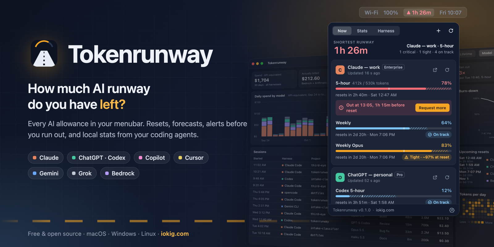
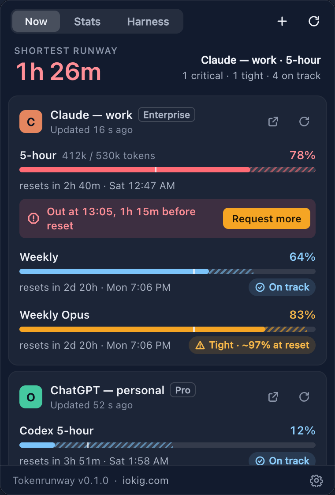
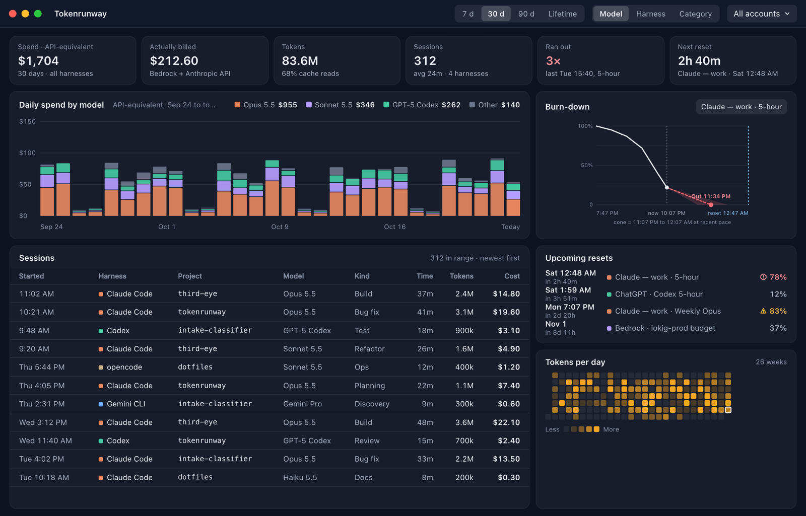
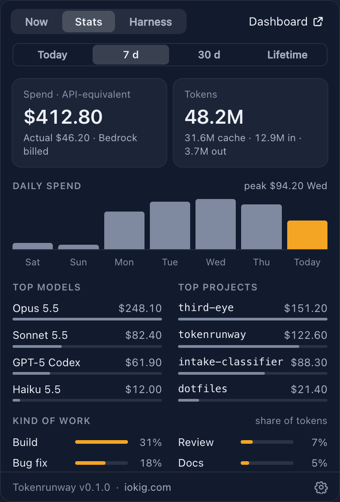
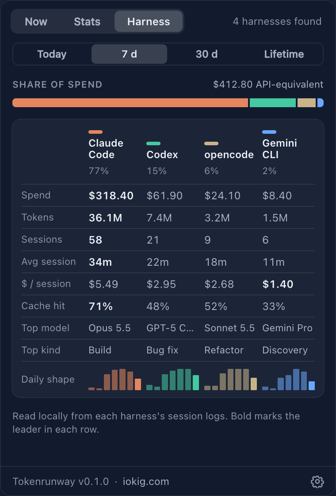
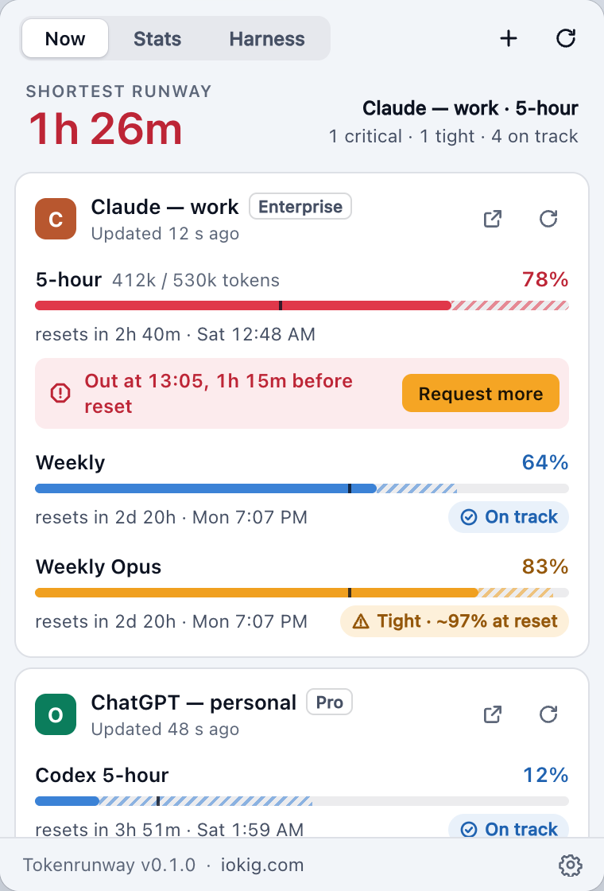
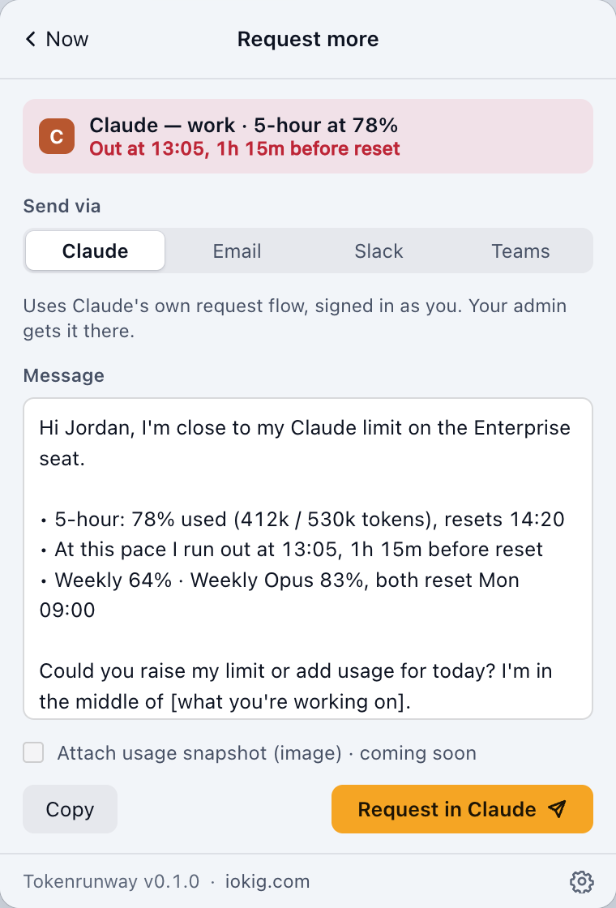
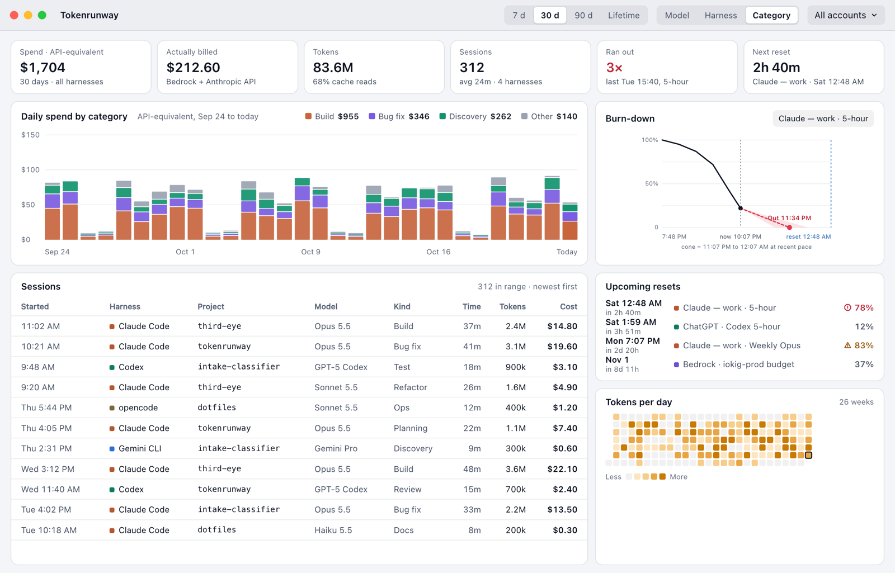

<p align="center">
  
</p>

<p align="center">
  <a href="https://github.com/slastrina/tokenrunway/releases/latest"></a>
  <a href="https://github.com/slastrina/tokenrunway/actions/workflows/ci.yml"></a>
  
  <a href="LICENSE"></a>
  <a href="https://www.iokig.com/tokenrunway"></a>
</p>

<p align="center">
  <b>How much AI runway do you have left?</b><br>
  A free, open-source menubar and system-tray app that puts all your AI subscriptions and API
  accounts in one place: how much of each allowance is left, when it resets, whether you'll run
  out first, and what your agents spend their tokens on.
</p>

<p align="center">
  <a href="#install"><b>Install</b></a> ·
  <a href="#screenshots"><b>Screenshots</b></a> ·
  <a href="#rattleboard"><b>Rattleboard</b></a> ·
  <a href="#build-from-source"><b>Build</b></a> ·
  <a href="SPEC.md"><b>Spec</b></a>
</p>

<br>

<table>
  <tr>
    <td width="50%" valign="top">
      
    </td>
    <td width="50%" valign="top">
      <h3>Allowances at a glance</h3>
      Claude (Pro, Max, Team, Enterprise), ChatGPT/Codex (Plus, Pro, Business, Enterprise),
      GitHub Copilot, Cursor, Gemini (CLI), Grok/xAI, AWS Bedrock budgets and the
      Anthropic/OpenAI API orgs and OpenRouter keys. Several accounts per provider.
      <h3>Resets and forecasts</h3>
      Every 5-hour, weekly and monthly window with its reset time, a pace marker, and a
      projection of when you'll run out at your current rate. The menubar shows your shortest
      runway.
      <h3>Alerts before you run out</h3>
      Notifications at your thresholds and when a forecast says you'll hit the wall before the
      reset, plus a one-click request to your administrator for more.
    </td>
  </tr>
</table>

### Features

- **Local stats from your agents' logs**: Claude Code, Codex, opencode and others. Spend per day,
  week, month and lifetime; your most-used models and projects; and what the work was (building,
  discovery, bug fixing…). Compare harnesses side by side.
- **Local models too**: LM Studio's requests, models and tokens, read from its server logs and
  shown as free.
- **Catch runaway sessions**: a warning when a session spends 3× your usual pace, so an agent
  loop doesn't eat your window.
- **Switch to save**: when a window is tight, it says where there's room (another model, or
  another seat).
- **Spend goals**: daily and monthly goals with rings on the Now tab and alerts at 80% and 100%.
- **Insights**: cost per project and git branch, cache-efficiency tips, a Monday recap of last
  week, and what your plan is worth at API prices ("your $200 plan did $874 of work, 4.4×").
- **A full dashboard** with daily spend by model, harness or category, a burn-down for any window,
  every session, upcoming resets and a contribution-style heatmap. Click a model or project in
  Stats to open it there.
- **Menubar your way**: runway, % left, or today's spend, for the most urgent window or one you
  pin. A copy button puts a usage summary on the clipboard.
- **`tokenrunway` on the command line**: `status`, `today`, and a one-line `statusline` for your
  shell prompt or Claude Code.
- **Sign in where there's no CLI**: Cursor and Grok can be signed in to inside Tokenrunway. Only
  the session cookie is kept, in your keychain.
- **Rattleboard**: alerts and an "AI runway" card on a split-flap board.
- **Updates itself** with release notes, and installs with Homebrew.
- **Private**: no account, no server, no telemetry. Your logins stay in your OS keychain, and your
  stats stay on your computer.

## Screenshots

<p align="center">
  
  <br><sub>The dashboard: daily spend by model, burn-down to the next reset, every session and what's resetting next.</sub>
</p>

<table>
  <tr>
    <td align="center" width="25%"><br><sub><b>Stats</b>: spend, tokens, top models and projects, kind of work</sub></td>
    <td align="center" width="25%"><br><sub><b>Harness</b>: Claude Code vs Codex vs opencode vs Gemini CLI</sub></td>
    <td align="center" width="25%"><br><sub><b>Light mode</b>: follows your system theme</sub></td>
    <td align="center" width="25%"><br><sub><b>Request more</b>: a prefilled ask to your admin</sub></td>
  </tr>
</table>

<p align="center">
  
  <br><sub>Grouped by kind of work: build, bug fix, discovery and more, classified locally from your sessions.</sub>
</p>

<sub>Screenshots use sample data.</sub>

## Install

| Platform | How |
|---|---|
| macOS 11+ (Apple Silicon and Intel) | `brew install --cask slastrina/tap/tokenrunway`, or the `.dmg` from [Releases](https://github.com/slastrina/tokenrunway/releases/latest) |
| Windows 10/11 | the `-setup.exe` or `.msi` from Releases |
| Linux x86_64 / arm64 | the `.deb` or `.AppImage` from Releases (needs libayatana-appindicator; on GNOME the AppIndicator extension) |

Tokenrunway checks GitHub for new versions once a day, shows what's new, and updates in place when
you say so. Homebrew installs update with `brew upgrade --cask tokenrunway`.

## Command line

The app doubles as a `tokenrunway` command. Homebrew puts it on your PATH; the `.deb` installs it
in `/usr/bin`; on Windows it's `tokenrunway.exe` in the install folder, and the AppImage takes the
same arguments.

```console
$ tokenrunway status          # every account's windows, resets and forecasts, and today's spend
$ tokenrunway statusline      # ▲ 1h 26m · Claude 5-hour 78% · $12.40 today
$ tokenrunway today           # today's spend by harness, model and project
$ tokenrunway status --json   # the same for scripts (also: today --json)
$ tokenrunway guard           # exit 0 if every window is under 90%, 1 with the reason if not
```

Homebrew also adds two shorter names for the same command, `runway` and `trw` (not `tr`, which
is the Unix tool): `runway status`, `trw today`, `runway guard`.

**Guard a script or agent loop**: `guard` prints nothing when it's safe, so it chains:

```sh
tokenrunway guard --max 80 && claude -p "fix the flaky tests"
tokenrunway guard --account work --window 5h --runout || echo "out of runway, try later"
```

`--max` sets the limit (% used, default 90), `--account` and `--window` narrow it (part of the
name, or `5h`, `weekly`), `--runout` also stops when a window is forecast to run out before it
resets, `-v` says what it checked and `--json` gives the details. Exit codes: 0 go, 1 over the
limit, 2 bad options, 3 can't tell (the app isn't running, or nothing matches); `--allow-unknown`
turns 3 into 0.

Allowances come from the running app (it shares them in its data folder), so start Tokenrunway
first; spend comes straight from your agents' logs. Set `NO_COLOR=1` to turn colours off.

**Claude Code status line**: add this to `~/.claude/settings.json`:

```json
{
  "statusLine": { "type": "command", "command": "tokenrunway statusline" }
}
```

## Rattleboard

Tokenrunway can show its alerts, and an "AI runway" card, on a [Rattleboard](https://github.com/slastrina/rattleboard)
split-flap board. In **Settings → Rattleboard**:

1. **Rattleboard on this computer:** click **Connect** next to *Found on this computer*. Turn on
   Rattleboard's **Settings → API server** first. Alerts go through the Rattleboard app, with its
   own key.
2. **A board on your network:** in that Rattleboard, **Settings → API server → Copy link** (turn on
   **Other devices**), paste the `rattleboard://pair?…` link and click **Connect**. Or open *or enter
   address and key*.
3. **Test** shows "TOKENRUNWAY CONNECTED" for 15 seconds. Pick which alerts go to the board, and turn
   on **Show an AI runway card in the rotation**. The card needs the board's key: on this computer,
   paste its pair link under *Add the key for the card*.

The key is kept in your OS keychain. The board only gets window names, percentages and reset
times. It never gets prompts or costs. **Disconnect** removes the card from the board and the key
from the keychain.

## Build from source

```sh
npm ci
npm run dev        # run it
npm run build      # installers in target/release/bundle
cargo test --workspace
```

Linux needs `libwebkit2gtk-4.1-dev libayatana-appindicator3-dev librsvg2-dev libdbus-1-dev libxdo-dev`.

Layout: `crates/tokenrunway-core` is the engine (providers, log ingest, pricing, forecasts, update
checks) with no Tauri dependency; `src-tauri` is the desktop app; `src` is its UI (plain HTML/JS).

## Releasing

1. `scripts/bump.sh 0.2.0`
2. Add `## [0.2.0] - YYYY-MM-DD` to [CHANGELOG.md](CHANGELOG.md). That section becomes the release
   notes and the in-app "What's new".
3. Commit, then `git tag v0.2.0 && git push --tags`. GitHub Actions builds and signs every
   platform, publishes the release and `latest.json` for the updater, and bumps the Homebrew cask.

## Unofficial endpoints

Some providers have no public usage API for subscriptions. For those, Tokenrunway reads what their
own CLIs already keep on your computer, or calls the endpoints their own apps call, for your own
account only. Those can change without notice. When one does, Tokenrunway keeps the last good
reading and says the source needs an update. The Gemini, Grok and xAI readers were built from
the providers' observed calls without a test account, so treat them as early.

## Licence

MIT. Not affiliated with Anthropic, OpenAI, Amazon, xAI, Google, GitHub or Cursor.

<p align="center"><sub>Made by <a href="https://www.iokig.com">iokig.com</a> · <a href="https://www.iokig.com/tokenrunway">Project page</a> · <a href="CHANGELOG.md">Changelog</a></sub></p>
