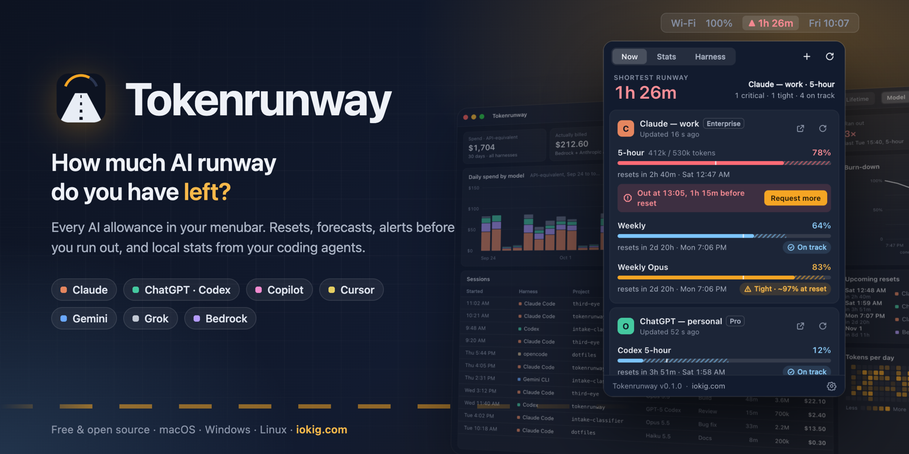
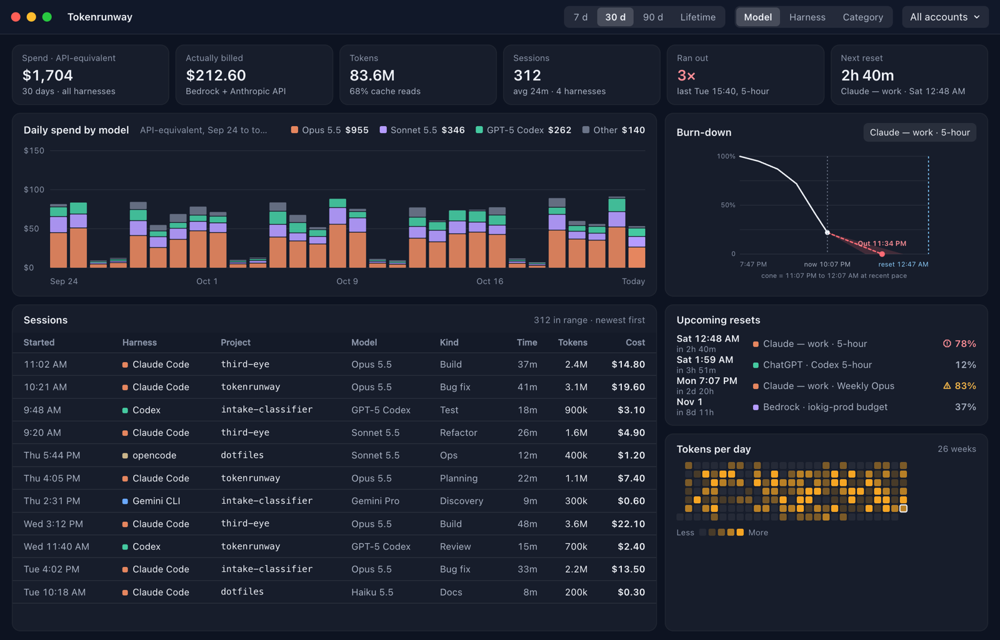
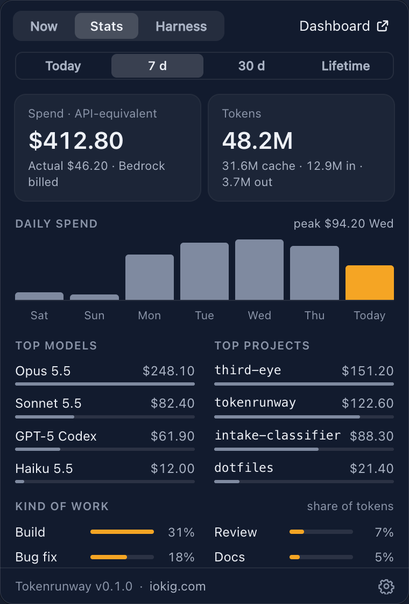
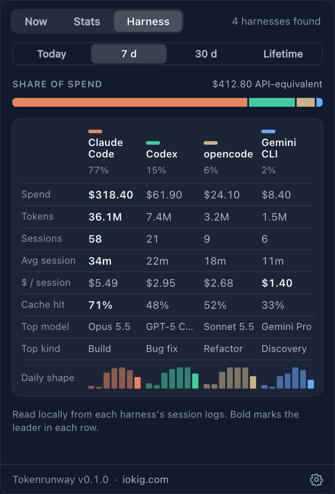
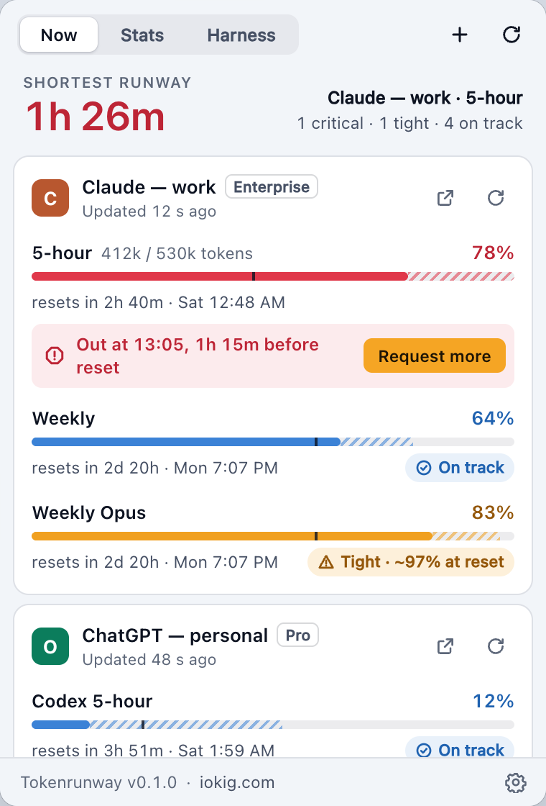
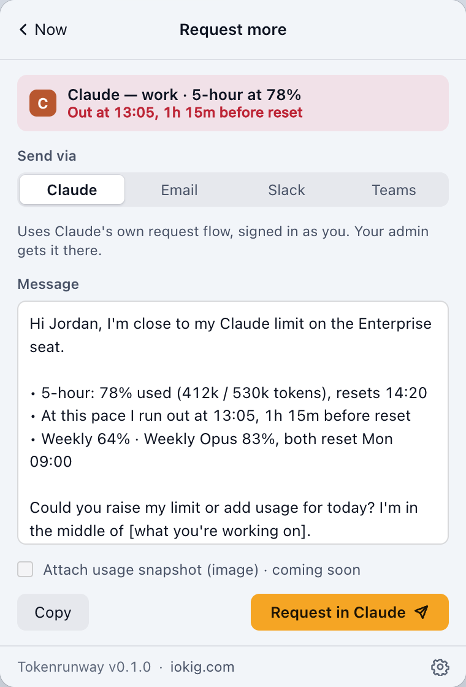
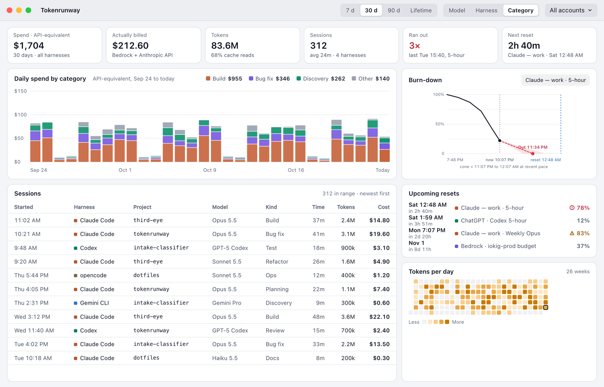

<p align="center">
  
</p>

<p align="center">
  <a href="https://github.com/slastrina/tokenrunway/releases/latest"></a>
  <a href="https://github.com/slastrina/tokenrunway/actions/workflows/ci.yml"></a>
  
  <a href="LICENSE"></a>
  <a href="https://www.iokig.com/tokenrunway"></a>
</p>

<p align="center">
  <b>How much AI runway do you have left?</b><br>
  A free, open-source menubar and system-tray app that puts all your AI subscriptions and API
  accounts in one place. See what’s left, when it resets, and whether you’re on pace to run out.
  Use the dashboard to see where your agents spend their tokens.
</p>

<p align="center">
  <a href="#install"><b>Install</b></a> ·
  <a href="#set-up-providers"><b>Provider setup</b></a> ·
  <a href="#command-line"><b>Command line</b></a> ·
  <a href="#screenshots"><b>Screenshots</b></a> ·
  <a href="#rattleboard"><b>Rattleboard</b></a> ·
  <a href="#build-from-source"><b>Build</b></a> ·
  <a href="SPEC.md"><b>Spec</b></a>
</p>

## Install

| Platform | How |
|---|---|
| macOS 11+ (Apple Silicon and Intel) | `brew install --cask slastrina/tap/tokenrunway`, or the `.dmg` from [Releases](https://github.com/slastrina/tokenrunway/releases/latest) |
| Windows 10/11 | The `-setup.exe` or `.msi` from [Releases](https://github.com/slastrina/tokenrunway/releases/latest) |
| Linux x86_64 / arm64 | The `.deb` or `.AppImage` from [Releases](https://github.com/slastrina/tokenrunway/releases/latest). Install libayatana-appindicator and enable the AppIndicator extension if you use GNOME. |

Tokenrunway checks GitHub for new versions once a day, shows what's new, and updates in place when
you say so. Homebrew installs update with `brew upgrade --cask tokenrunway`.

## Set up providers

1. Open Tokenrunway from the menu bar or system tray.
2. If the **Now** tab lists a login under **Found on this Mac**, **Found on this PC**, or **Found on this computer**, click **Add** beside it.
3. To add an account manually, open **Settings → Accounts → Add account**, select the provider, then follow the steps below.

Auto-detection suggests an account from a local sign-in or AWS profile. Click **Add** or **Connect** to start tracking it.

| Provider | What to set up first | How it appears in Tokenrunway | What you’ll see |
|---|---|---|---|
| **Claude** | Install [Claude Code](https://code.claude.com/docs/en/setup) and run `claude auth login` with your Claude subscription. | Auto-detects a saved Claude Code login. Manual path is **Claude → Use my CLI login**. | Five-hour and weekly usage, model-specific limits, and extra usage where reported. |
| **ChatGPT / Codex** | Install Codex CLI and [sign in with ChatGPT](https://learn.chatgpt.com/docs/auth#codex-cli) using `codex login`. Tokenrunway looks for a file-based login in `~/.codex/auth.json` or under `CODEX_HOME`. | Auto-detects the saved Codex login. Manual path is **ChatGPT / Codex → Use my CLI login**. | Reported Codex limits, reset times, and workspace or credit limits when available. |
| **Google Antigravity** | Install [Antigravity CLI](https://antigravity.google/docs/getting-started?tab=cli) (`agy` 1.1.11 or later). Run `agy` and sign in with Google. | Auto-detects an installed CLI with a local Antigravity profile. Manual path is **Google Antigravity → Use Antigravity CLI login**. | Reported five-hour and weekly quotas per model group. |
| **Gemini CLI** | Run `gemini` and sign in with an eligible [Gemini Code Assist](https://docs.cloud.google.com/gemini/docs/codeassist/gemini-cli) account. | Auto-detects saved Gemini CLI credentials. Manual path is **Gemini → Use Gemini CLI login**. | Reported daily model quotas and reset times. |
| **GitHub Copilot** | Run [`gh auth login`](https://docs.github.com/en/github-cli/github-cli/authenticating-with-github-cli) with the account that has Copilot, or sign in to Copilot in your editor. | Auto-detects supported GitHub CLI or editor logins. Manual paths are **GitHub Copilot → Use GitHub CLI login** or **Paste token**. | Included requests and other quota windows GitHub reports for the plan. |
| **Cursor** | For auto-detection, sign in to the Cursor desktop app on this computer. | Choose **Use Cursor app login** when detected. Under **Cursor**, you can also choose **Log in** to sign in inside Tokenrunway or **Paste session cookie** to supply the `WorkosCursorSessionToken` value. | Monthly plan usage and on-demand spend where available. |
| **Grok** | Have a SuperGrok or eligible X Premium account. | Manual. Choose **Grok / xAI → Log in**, then sign in at Grok in the window that opens. | Query limits returned by Grok. |
| **xAI API** | Create an API key in the [xAI Console](https://console.x.ai/). | Manual. Choose **Grok / xAI → Paste xAI API key**. | Key status. The card has a shortcut to the provider’s API limits page. |
| **AWS Bedrock** | Install AWS CLI and configure a profile with Cost Explorer and AWS Budgets read access. For SSO, use [`aws configure sso` and `aws sso login --profile PROFILE`](https://docs.aws.amazon.com/cli/latest/userguide/cli-configure-sso.html). | Auto-detects configured profiles. Choose **AWS Bedrock → Use AWS profile**, then pick the profile you want. | Month-to-date Bedrock spend and the matching AWS Budget if one exists. |
| **Anthropic API** | Create a Claude Console organization [Admin API key](https://platform.claude.com/docs/en/manage-claude/admin-api-keys) (`sk-ant-admin01-…`). | Manual. Choose **Anthropic API → Paste API key**. | Monthly API spend and a budget window if configured. |
| **OpenAI API** | Create an [organization Admin API key](https://platform.openai.com/settings/organization/admin-keys) (`sk-admin-…`). | Manual. Choose **OpenAI API → Paste API key**. | Monthly API spend and a budget window if configured. |
| **OpenRouter** | Create a key in [OpenRouter](https://openrouter.ai/settings/keys). Use a management key if you also want the account credit balance. | Manual. Choose **OpenRouter → Paste API key**. | Key limits or budgets, spend, and account credits when permitted. |

**When a login expires**, use **Log in again** where available. Complete the provider’s sign-in,
then click **Check again**. For AWS SSO, run `aws sso login --profile PROFILE` in your terminal.
Pasted keys and session cookies go in your system keychain.

**If a signed-in tool is missing**, check that you ran it under the same OS account as Tokenrunway.
For Codex, check [where the CLI saves credentials](https://learn.chatgpt.com/docs/auth#credential-storage).
Tokenrunway can discover Codex when the CLI saves an `auth.json` file. If your workspace allows
file-based storage, set `cli_auth_credentials_store = "file"` in Codex’s `config.toml` and sign in
again. Treat `auth.json` like a password.

**When a limit is tight**, **Request more** opens the provider’s own request page for eligible
Claude, ChatGPT, and GitHub Copilot workspace accounts. Other limit warnings can open a draft
message for your admin. Where available, account cards also link to quota, spending, or credit settings.

### Local usage and spend

**Stats**, **Harness**, and the dashboard automatically read local sessions from Claude Code,
Codex, Antigravity, and opencode. For LM Studio, start its local server and send it a request so it has a
server log to read. Use the app on the same computer and user account that ran the tool.
Local stats appear independently of the allowance accounts under **Add account**.

Antigravity stats are imported automatically from supported conversation databases under
`~/.gemini/antigravity-cli/conversations`, `~/.gemini/antigravity`,
`~/.gemini/antigravity/conversations`, and `~/.gemini/antigravity-ide/conversations`.
Tokenrunway honours `GEMINI_CLI_HOME` as an override for `~/.gemini`. This import reads the
main generation records that have token counts and a reliable timestamp. It shows API-equivalent
estimates for known models. Totals can be partial when a database has unrecognised records or
stores usage only in retries or step records. These are machine-local sessions across logins.
[Public Antigravity format references](https://github.com/steipete/CodexBar/blob/main/docs/antigravity.md#local-token-history)
· [ccusage field mappings](https://github.com/ccusage/ccusage/blob/main/rust/adapters/antigravity/src/parser/proto.rs)


### What you can track

- **Allowance runway.** See usage, reset countdowns, and projected exhaustion. Pin a window to the menu bar and set alerts for tight limits or unused allowance about to reset.
- **Spending and activity.** Track daily and monthly spend goals, API-equivalent cost, models, projects, and what you worked on. Open a session to see its token breakdown and tool names. Compare harnesses and spot unusually expensive sessions.
- **Sharing and automation.** Copy an allowance summary, send alerts to [Rattleboard](#rattleboard), or use the [command line](#command-line) to check allowance before running a script.

## Screenshots

<p align="center">
  
  <br><sub>The dashboard: daily spend by model, burn-down to the next reset, every session and what's resetting next.</sub>
</p>

<table>
  <tr>
    <td align="center" width="25%"><br><sub><b>Stats</b>: spend, tokens, top models and projects, kind of work</sub></td>
    <td align="center" width="25%"><br><sub><b>Harness</b>: compare local agent activity</sub></td>
    <td align="center" width="25%"><br><sub><b>Light mode</b>: follows your system theme</sub></td>
    <td align="center" width="25%"><br><sub><b>Request more</b>: an example admin draft</sub></td>
  </tr>
</table>

<p align="center">
  
  <br><sub>Grouped by kind of work: build, bug fix, discovery and more, classified locally from your sessions.</sub>
</p>

<sub>Screenshots use sample data.</sub>

## Command line

The app doubles as a `tokenrunway` command. Homebrew puts it on your PATH; the `.deb` installs it
in `/usr/bin`; on Windows it's `tokenrunway.exe` in the install folder, and the AppImage takes the
same arguments.

```console
$ tokenrunway status          # every account's windows, resets and forecasts, and today's spend
$ tokenrunway statusline      # ▲ 1h 26m · Claude 5-hour 78% · $12.40 today
$ tokenrunway today           # today's spend by harness, model and project
$ tokenrunway status --json   # the same for scripts (also: today --json)
$ tokenrunway guard           # exit 0 if every window is under 90%, 1 with the reason if not
```

Homebrew also adds two shorter names for the same command, `runway` and `trw` (not `tr`, which
is the Unix tool): `runway status`, `trw today`, `runway guard`.

**Guard a script or agent loop**: `guard` prints nothing when it's safe, so it chains:

```sh
tokenrunway guard --max 80 && claude -p "fix the flaky tests"
tokenrunway guard --account work --window 5h --runout || echo "out of runway, try later"
```

`--max` sets the limit (% used, default 90), `--account` and `--window` narrow it (part of the
name, or `5h`, `weekly`), `--runout` also stops when a window is forecast to run out before it
resets, `-v` says what it checked and `--json` gives the details. Exit codes: 0 go, 1 over the
limit, 2 bad options, 3 can't tell (the app isn't running, or nothing matches); `--allow-unknown`
turns 3 into 0.

Allowances come from the running app (it shares them in its data folder), so start Tokenrunway
first; spend comes straight from your agents' logs. Set `NO_COLOR=1` to turn colours off.

**Claude Code status line**: add this to `~/.claude/settings.json`:

```json
{
  "statusLine": { "type": "command", "command": "tokenrunway statusline" }
}
```

## Rattleboard

Tokenrunway can show its alerts, and an "AI runway" card, on a [Rattleboard](https://github.com/slastrina/rattleboard)
split-flap board. In **Settings → Rattleboard**:

1. **Rattleboard on this computer:** click **Connect** next to *Found on this computer*. Turn on
   Rattleboard's **Settings → API server** first. Alerts go through the Rattleboard app, with its
   own key.
2. **A board on your network:** in that Rattleboard, **Settings → API server → Copy link** (turn on
   **Other devices**), paste the `rattleboard://pair?…` link and click **Connect**. Or open *or enter
   address and key*.
3. **Test** shows "TOKENRUNWAY CONNECTED" for 15 seconds. Pick which alerts go to the board, and turn
   on **Show an AI runway card in the rotation**. The card needs the board's key: on this computer,
   paste its pair link under *Add the key for the card*.

The key is kept in your OS keychain. The board only gets window names, percentages and reset
times. It never gets prompts or costs. **Disconnect** removes the card from the board and the key
from the keychain.

## Build from source

```sh
npm ci
npm run dev        # run it
npm run build      # installers in target/release/bundle
cargo test --workspace
```

Linux needs `libwebkit2gtk-4.1-dev libayatana-appindicator3-dev librsvg2-dev libdbus-1-dev libxdo-dev`.

Layout: `crates/tokenrunway-core` is the engine (providers, log ingest, pricing, forecasts, update
checks) with no Tauri dependency; `src-tauri` is the desktop app; `src` is its UI (plain HTML/JS).

## Releasing

1. Run `scripts/bump.sh VERSION` with the new version.
2. Add the matching version and date heading to [CHANGELOG.md](CHANGELOG.md). The section becomes
   the GitHub release notes and the in-app What's new.
3. Commit the changes, create the annotated `vVERSION` tag on that commit, and push the branch and
   tag. The [Release workflow](.github/workflows/release.yml) builds installers, publishes
   `latest.json` for in-app updates. The [Homebrew tap workflow](https://github.com/slastrina/homebrew-tap/actions/workflows/sync-casks.yml)
   checks for the published macOS installer every six hours and updates the cask.

## Data and privacy

Tokenrunway runs on your computer and has no Tokenrunway account or telemetry. Provider connections
read allowance data using your existing logins, AWS profiles, or credentials saved in the system
keychain. Session stats come from local logs. Tokenrunway stores usage and tool names without
retaining prompts or tool arguments.

Some subscription providers expose usage through their app or CLI endpoints. When a response
changes, Tokenrunway keeps the last good reading and marks the source for attention. See the
[allowance sources](SPEC.md#51-allowance-plane) for endpoint and verification details.

## Licence

MIT. Not affiliated with Anthropic, OpenAI, Amazon, xAI, Google, GitHub or Cursor.

<p align="center"><sub>Made by <a href="https://www.iokig.com">iokig.com</a> · <a href="https://www.iokig.com/tokenrunway">Project page</a> · <a href="CHANGELOG.md">Changelog</a></sub></p>
